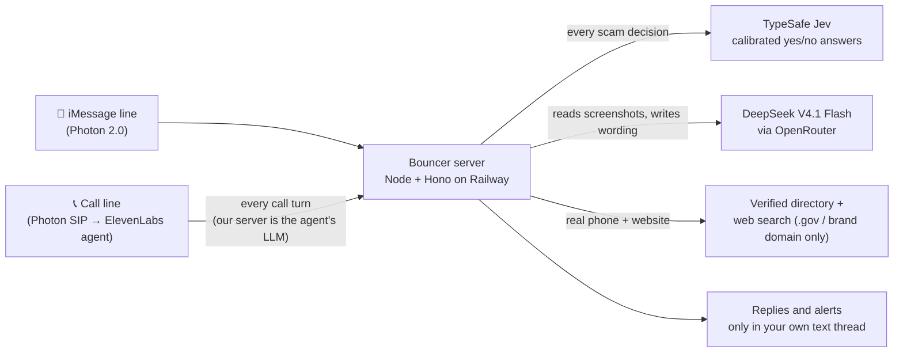

# Bouncer

**Scam help you can text and call.** Send Bouncer a sketchy text or a screenshot and it tells you, in plain words, whether it's a scam and what to do. Merge it into a suspicious phone call and it listens quietly, then texts you a warning the moment the call turns into a scam.

Built at HackUTD 2026 for the T-Mobile scam-prevention track and the Photon messaging-agent track.

## Why this matters

Scams are now one of the most common crimes in America, and they get worse every year.

- **$15.9 billion.** That's what Americans reported losing to fraud in 2025, a record and roughly a quarter more than the year before. The FTC got **3 million fraud reports**, and it says the real total is higher because many victims never report. ([FTC, March 2026](https://www.ftc.gov/news-events/news/press-releases/2026/03/ftc-testifies-joint-economic-committee-agencys-efforts-combat-fraud))
- **$7.75 billion lost by people 60 and older** in 2025, up 59% in a single year, across more than 200,000 complaints to the FBI. ([FBI IC3 2025 report, via AARP](https://www.aarp.org/money/scams-fraud/fbi-ftc-report-2025-losses.html))
- **AI is making it personal.** Seniors filed more than 3,100 FBI complaints about scams that used AI in 2025, with over $352 million lost. A scammer can clone a voice from a few seconds of audio taken from a social-media video or a voicemail, and in a McAfee survey 70% of people said they weren't sure they could tell a cloned voice from the real one.

The cruelest version is the **"family emergency" call**: the phone rings and it's your grandson's voice, crying, saying he's been in an accident or arrested, he needs bail money right now, and please don't tell Mom. The voice is fake. The panic is real, and the money is gone within the hour.

Spam labels act before a call and fraud reports come after the money is gone. The moment that matters is the middle, while the scammer is still talking. That's where Bouncer sits.

## Voice-clone calls: Bouncer checks with your real family

A cloned voice can sound exactly like your grandson. It can't answer from his real phone. So Bouncer calls him there.

1. **Bouncer listens.** You merge Bouncer into the call (or text it "Mom is calling, she says she's in trouble"). It stays silent and scores every turn of the conversation.
2. **It spots the pattern.** When the caller claims to be a family member in trouble, Bouncer texts *you*, privately: *"Ask him for the family safe word. Don't say it yourself, and don't send money yet."* The person on the line never hears it.
3. **It calls your real relative.** With your YES by text, Bouncer places its own phone call to the number your family registered for that person and checks that they're okay.
4. **It texts you the truth.** If your relative is safe and never called you, Bouncer tells you to hang up. If they really do need help, it tells you that too.
5. **The whole family knows.** Everyone in your family circle who turned on alerts gets a text that someone in the family was just targeted by a fake family-emergency scam (the type of scam only, never the details).

Set it up by texting **SET UP FAMILY**: add each person the way you call them ("Grandma", "Jake"), their phone number, and a safe word only your family knows. Family members join with a code by text. The safe word is encrypted and Bouncer never says it out loud, because the voice on the other end of the call might be the scammer.

What used to leave a panicked grandparent alone with a stranger's script now ends with a text from someone they trust, *before* any money moves.

---

## Try it yourself (judges start here)

**Sign-up link:** **https://hackutd-26-production.up.railway.app/join?code=HACKUTD**

**Team code:** `HACKUTD` (the link above fills it in for you)

1. Open the link **on your iPhone**. You can also scan the QR code at [/join/qr](https://hackutd-26-production.up.railway.app/join/qr), a separate page made for slides and screens.
2. Enter the phone number your iPhone uses for iMessage, check that the team code is `HACKUTD`, tick the box, and tap **Get Bouncer**.
3. Tap **Text "hi" to Bouncer**. Bouncer can't text you first, so this first text starts the conversation.
4. Reply **YES** to its welcome message to turn on call protection, and tap **Save Bouncer to contacts**. The contact card has both numbers.

| | Number | Use it for |
|---|---|---|
| 💬 Text line | **(628) 998-8619** | texts, screenshots, questions, replies like YES |
| 📞 Call line | **(617) 993-9248** | calling Bouncer, or merging it into a call that feels off |

The sign-up page shows the exact text number for you. These are two separate numbers on purpose: texts to the call line and calls to the text line don't reach Bouncer.

**If something doesn't work**

- **No reply to your first text:** check Settings → Messages → Send & Receive. iMessage has to send from the phone number you signed up with, not only from an email.
- **"Sign-up isn't switched on yet" or "Sign-ups are full":** find the Bouncer team and we'll add you by hand.
- **Signed up twice?** That's fine: the page says "You're already set up" and shows the same number.

## Things to try

| Try this | What happens |
|---|---|
| **Paste a scam text**, e.g. `USPS: your package is on hold, update your address at usps-redeliver.info` | A verdict (Looks safe / Not sure / Likely scam / High risk), up to three red flags, and one safe next step. Then a 📞 line with the **real** organization's phone number and website, verified on its official site. Bouncer never sends a scam's link or number back to you. |
| **Send a screenshot** of a scam text, DM or email | Bouncer reads the picture, checks it the same way, and drops the image right away. |
| **Call (617) 993-9248 with a friend playing a scammer.** Add Call → Bouncer → Merge, then have them say "This is your bank, read me the code we just sent." | Bouncer stays silent and texts you a warning during the call. Say **"Hey Bouncer, is this real?"** and it answers out loud in two sentences or less; "Thanks Bouncer" makes it go quiet again. After you hang up, you get a call summary by text. |
| **After that call, text "I already paid"** | Bouncer remembers the call for 30 minutes. If the caller asked for Klarna, it asks "It sounds like you paid with Klarna after that call. Is that right?" and walks you through the steps one at a time, including the service's verified number. |
| **Text "SET UP FAMILY"** | Make a family circle with a secret safe word. Later, text something like "Mom is calling, she says she's in trouble": Bouncer tells you to ask the caller for the safe word and calls your relative's own number to check on them. (If it hears this on a call instead, it asks for a YES by text first.) It never says the word out loud. |
| **Reply REPORT** after a scam verdict | Shares an anonymous version of the scam (no names, numbers or links) so people nearby can be warned. Text `ZIP 75080` (any ZIP) to get local alerts. |

## How it works



- **Jev decides, the language model only writes the words.** Every scam verdict comes from TypeSafe Jev's calibrated probabilities. The language model never decides whether something is a scam.
- **Silent on calls by design.** Our server answers each call turn with ElevenLabs' `skip_turn` within milliseconds, runs Jev in the background, and texts you. It only speaks after "Hey Bouncer".
- **Nothing happens from voice alone.** A scammer on a merged call can say "Hey Bouncer" too, so calling a relative or alerting family always needs a YES by text.
- **Two lines on purpose.** Caller ID is easy to fake; an iMessage thread isn't. Private things (like your family's safe word) and every action only go through your own text thread, never through the call.

## Accuracy

| Test | Result |
|---|---|
| 1,160 held-out texts (Mendeley SMS phishing set), scored once | **Caught 104 of 106 scams (98%)**; flagged **19 of 967 normal texts (2%)** |
| 30 hand-written current U.S. texts (tolls, Zelle, Coinbase, jobs) | Flagged 16 of 17 scams; none of the 17 called "Looks safe" |
| 430 scam call scripts | All scored Likely scam or higher; **326 (76%)** got a warning text |
| 37 realistic multi-turn scam calls | **16** got a warning text |
| 22 normal calls | **0 false alarms** (no warning texts) |

The text numbers were measured before a later rule that cuts false alarms further. On calls, the current rule only sends a warning text once someone actually asks for money, a code or access to your device, which trades some missed alerts for fewer false ones; the 22 normal calls in the test are easy ones. Methods, thresholds and caveats are in [docs/EVAL.md](docs/EVAL.md), [docs/EVAL_CALLS.md](docs/EVAL_CALLS.md) and [docs/EVAL_ARCHIVE.md](docs/EVAL_ARCHIVE.md).

## Privacy

- Bouncer doesn't store your messages, screenshots, call audio or call transcripts. Screenshots are dropped as soon as they're read; call transcripts live in memory and are deleted when you hang up.
- The database keeps only the type of check, the risk level, the names of red flags and the outcome.
- Your chat, and the key facts of a scam it just checked, are remembered for 30 minutes so Bouncer can follow up, then forgotten.
- Family safe words are encrypted (AES-256-GCM) and never spoken.
- The sign-up page never logs phone numbers or names.

## What's next

The prototype covers one person texting and calling Bouncer. Here's where we'd take it.

### Scam Shield at the carrier level (concept mock-up)

Today Bouncer only sees what someone sends it. With T-Mobile's network behind it, people wouldn't have to forward anything. A clickable mock-up of a carrier console is on the [`mockups` branch](https://github.com/RojanSaatsaz/HackUTD-26/tree/mockups/docs/mockups): [`carrier-dashboard.html`](https://github.com/RojanSaatsaz/HackUTD-26/blob/mockups/docs/mockups/carrier-dashboard.html). Every number in it is simulated; download the file and open it in a browser.

- **Detect:** score incoming texts inside the network, throw the content away, and move high-risk fraud into a review queue.
- **Learn:** group scams into anonymous templates (what REPORT already does) and flag a template that is spreading fast across ZIP codes.
- **Warn ahead:** when a scam spikes, send people in that area one short heads-up before it reaches them (at most one a day), and check whether warned people tap fewer scam links.
- **Protect:** text the customer within about a second and a half of a scam text arriving, with no screenshot or forwarding.

The pieces already exist in this repo: `src/carrier` replays simulated carrier events, `src/patterns` finds spikes, and `src/dashboard` is a password-protected dashboard. Real network access is the missing part.

### More places people get scammed

Scams don't stay in one app. Bouncer's checks take plain text or a picture and return a verdict; only the messaging layer (`src/photon`) is tied to iMessage. Next channels:

- **SMS and RCS**, for Android phones and anyone not on iMessage.
- **WhatsApp, Telegram and Facebook Messenger**, where job, crypto and "wrong number" scams often start.
- **Email:** forward a suspicious email to a Bouncer address and get the same verdict, red flags and real contact info.

Screenshots from any of these apps already work today; a direct channel removes that step. Every new channel keeps the same rules: Jev decides, no content is stored, and every action needs a YES in the person's own thread.

### Privacy, consent and security before a real launch

A planning page on the same branch, [`consent-and-security.html`](https://github.com/RojanSaatsaz/HackUTD-26/blob/mockups/docs/mockups/consent-and-security.html), covers the legal work and an interactive consent checker. It isn't legal advice; a lawyer would review every point before Bouncer listens to real customers' calls.

- **Call consent by state.** Bouncer doesn't record calls, but it listens and transcribes them live, and some wiretap laws ([California Penal Code § 632](https://leginfo.legislature.ca.gov/faces/codes_displaySection.xhtml?lawCode=PEN&sectionNum=632)) cover listening, not just recording. 11 states require everyone on a call to agree, and we'd treat 2 unclear states (Connecticut, Michigan) the same way. Plan: a consent checker decides at the start of each call whether Bouncer's first words are a one-line notice ("This call is being screened for scams by T-Mobile"). It gives the notice whenever anything is unknown, which today includes every merged call. If a scammer hangs up on hearing it, that's a win too.
- **Vendors.** Contracts with ElevenLabs and the language-model providers that forbid training on or reusing call data, and zero-retention modes where they exist.
- **AI voice calls.** The FCC treats AI voices as "artificial" voices under the TCPA, so verification calls need prior consent. Bouncer already calls only relatives who joined the family circle, and only after a YES by text; next is keeping a timestamped record of that consent, with no content.
- **Carrier data.** Screening messages at the network level touches customer network data (CPNI) under FCC rules. It needs T-Mobile legal and privacy review and a clear customer opt-in first.
- **Privacy rights.** A privacy notice and STOP, HELP and DELETE MY DATA text commands (California's CCPA/CPRA and similar laws).
- **No voiceprints.** Speech-to-text only, no identifying people by their voice (Illinois' BIPA), unless someone gives written consent.
- **One spoofing gap to close.** The verification call asks the relative to say the safe word, so a scammer who fakes Bouncer's call number could ask for it too. Fix: text the relative from the text line first ("Bouncer is calling you now"), or have them send the word by text in their own thread.

### Signing people up at scale

The `/join` link works for an event. For real customers: turn Bouncer on from the T-Mobile account (T-Life app or in a store), confirm the phone number with a code first, and move from Photon's shared iMessage line, which has a per-project cap, to a dedicated line anyone can text directly.

## Tech stack

Node 22 + TypeScript (run with `tsx`) · Hono · PostgreSQL · Railway (Docker) · [Photon 2.0](https://photon.codes) (iMessage + voice over SIP) · [ElevenLabs Agents](https://elevenlabs.io) (our server is the custom LLM) · [TypeSafe Jev](https://docs.typesafe.ai) `jev-1.14.0` · DeepSeek V4.1 Flash via [OpenRouter](https://openrouter.ai) (Gemini as fallback)

## Run it yourself

```bash
npm install
npm run dev          # local server on :3000, reads .env
npm run migrate      # create tables (also runs on every server start)
npm run typecheck
```

Every environment variable is listed in [CLAUDE.md](CLAUDE.md#environment-variables). Keep `.env` out of git.

- **Database:** Postgres runs on Railway with no public address. Locally, run `railway connect Postgres --tunnel-only --port 54329` and point `DATABASE_URL` at `127.0.0.1:54329`. The tunnel closes whenever Railway redeploys.
- **One Photon connection at a time:** Railway holds the iMessage connection (`PHOTON_SOCKET=on`). Keep `PHOTON_SOCKET=off` locally, or every message gets two replies.
- **Tests:** `npm run test:message`, `test:call`, `test:postcall`, `test:recovery`, `test:case`, `test:contacts`, `test:signup` and more (all in `package.json`). They use `DRY_RUN=1`, so nothing is texted to real phones.
- **Deploy:** pushing to `main` deploys to Railway (Dockerfile build).

## Repo map

```
src/messages/   iMessage router, chat memory, case memory
src/detection/  Jev questions, risk levels, screenshot reading, reply wording
src/voice/      call endpoint (custom LLM), talk mode, call summaries
src/family/     family circles, safe words, verification calls
src/recovery/   "I already paid" checklists
src/patterns/   REPORT, anonymous templates, local spike alerts
src/contacts/   verified real phone numbers and websites
src/signup/     the /join sign-up page
src/dashboard/  T-Mobile carrier dashboard (password-protected)
docs/           SPEC.md (full spec), API_NOTES.md, EVAL*.md
```
