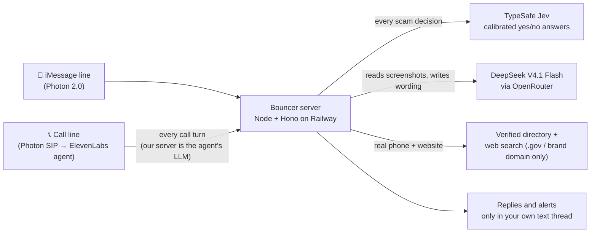

# Bouncer

**Scam help you can text and call.** Send Bouncer a sketchy text or a screenshot and it tells you, in plain words, whether it's a scam and what to do. Merge it into a suspicious phone call and it listens quietly, then texts you a warning the moment the call turns into a scam.

Built at HackUTD 2026 for the T-Mobile scam-prevention track and the Photon messaging-agent track.

---

## Try it yourself (judges start here)

**Sign-up link:** **https://hackutd-26-production.up.railway.app/join?code=HACKUTD**

**Team code:** `HACKUTD` (the link above fills it in for you)

1. Open the link **on your iPhone**. You can also scan the QR code at [/join/qr](https://hackutd-26-production.up.railway.app/join/qr), a separate page made for slides and screens.
2. Enter the phone number your iPhone uses for iMessage, check that the team code is `HACKUTD`, tick the box, and tap **Get Bouncer**.
3. Tap **Text "hi" to Bouncer**. Bouncer can't text you first, so this first text starts the conversation.
4. Reply **YES** to its welcome message to turn on call protection, and tap **Save Bouncer to contacts**. The contact card has both numbers.

| | Number | Use it for |
|---|---|---|
| 💬 Text line | **(628) 998-8619** | texts, screenshots, questions, replies like YES |
| 📞 Call line | **(617) 993-9248** | calling Bouncer, or merging it into a call that feels off |

The sign-up page shows the exact text number for you. These are two separate numbers on purpose: texts to the call line and calls to the text line don't reach Bouncer.

**If something doesn't work**

- **No reply to your first text:** check Settings → Messages → Send & Receive. iMessage has to send from the phone number you signed up with, not only from an email.
- **"Sign-up isn't switched on yet" or "Sign-ups are full":** find the Bouncer team and we'll add you by hand.
- **Signed up twice?** That's fine: the page says "You're already set up" and shows the same number.

## Things to try

| Try this | What happens |
|---|---|
| **Paste a scam text**, e.g. `USPS: your package is on hold, update your address at usps-redeliver.info` | A verdict (Looks safe / Not sure / Likely scam / High risk), up to three red flags, and one safe next step. Then a 📞 line with the **real** organization's phone number and website, verified on its official site. Bouncer never sends a scam's link or number back to you. |
| **Send a screenshot** of a scam text, DM or email | Bouncer reads the picture, checks it the same way, and drops the image right away. |
| **Call (617) 993-9248 with a friend playing a scammer.** Add Call → Bouncer → Merge, then have them say "This is your bank, read me the code we just sent." | Bouncer stays silent and texts you a warning during the call. Say **"Hey Bouncer, is this real?"** and it answers out loud in two sentences or less; "Thanks Bouncer" makes it go quiet again. After you hang up, you get a call summary by text. |
| **After that call, text "I already paid"** | Bouncer remembers the call for 30 minutes. If the caller asked for Klarna, it asks "It sounds like you paid with Klarna after that call. Is that right?" and walks you through the steps one at a time, including the service's verified number. |
| **Text "SET UP FAMILY"** | Make a family circle with a secret safe word. Later, text something like "Mom is calling, she says she's in trouble": Bouncer tells you to ask the caller for the safe word and calls your relative's own number to check on them. (If it hears this on a call instead, it asks for a YES by text first.) It never says the word out loud. |
| **Reply REPORT** after a scam verdict | Shares an anonymous version of the scam (no names, numbers or links) so people nearby can be warned. Text `ZIP 75080` (any ZIP) to get local alerts. |

## How it works



- **Jev decides, the language model only writes the words.** Every scam verdict comes from TypeSafe Jev's calibrated probabilities. The language model never decides whether something is a scam.
- **Silent on calls by design.** Our server answers each call turn with ElevenLabs' `skip_turn` within milliseconds, runs Jev in the background, and texts you. It only speaks after "Hey Bouncer".
- **Nothing happens from voice alone.** A scammer on a merged call can say "Hey Bouncer" too, so calling a relative or alerting family always needs a YES by text.
- **Two lines on purpose.** Caller ID is easy to fake; an iMessage thread isn't. Private things (like your family's safe word) and every action only go through your own text thread, never through the call.

## Accuracy

| Test | Result |
|---|---|
| 1,160 held-out texts (Mendeley SMS phishing set), scored once | **Caught 104 of 106 scams (98%)**; flagged **19 of 967 normal texts (2%)** |
| 30 hand-written current U.S. texts (tolls, Zelle, Coinbase, jobs) | Flagged 16 of 17 scams; none of the 17 called "Looks safe" |
| 430 scam call scripts | All scored Likely scam or higher; **326 (76%)** got a warning text |
| 37 realistic multi-turn scam calls | **16** got a warning text |
| 22 normal calls | **0 false alarms** (no warning texts) |

The text numbers were measured before a later rule that cuts false alarms further. On calls, the current rule only sends a warning text once someone actually asks for money, a code or access to your device, which trades some missed alerts for fewer false ones; the 22 normal calls in the test are easy ones. Methods, thresholds and caveats are in [docs/EVAL.md](docs/EVAL.md), [docs/EVAL_CALLS.md](docs/EVAL_CALLS.md) and [docs/EVAL_ARCHIVE.md](docs/EVAL_ARCHIVE.md).

## Privacy

- Bouncer doesn't store your messages, screenshots, call audio or call transcripts. Screenshots are dropped as soon as they're read; call transcripts live in memory and are deleted when you hang up.
- The database keeps only the type of check, the risk level, the names of red flags and the outcome.
- Your chat, and the key facts of a scam it just checked, are remembered for 30 minutes so Bouncer can follow up, then forgotten.
- Family safe words are encrypted (AES-256-GCM) and never spoken.
- The sign-up page never logs phone numbers or names.

## Tech stack

Node 22 + TypeScript (run with `tsx`) · Hono · PostgreSQL · Railway (Docker) · [Photon 2.0](https://photon.codes) (iMessage + voice over SIP) · [ElevenLabs Agents](https://elevenlabs.io) (our server is the custom LLM) · [TypeSafe Jev](https://docs.typesafe.ai) `jev-1.14.0` · DeepSeek V4.1 Flash via [OpenRouter](https://openrouter.ai) (Gemini as fallback)

## Run it yourself

```bash
npm install
npm run dev          # local server on :3000, reads .env
npm run migrate      # create tables (also runs on every server start)
npm run typecheck
```

Every environment variable is listed in [CLAUDE.md](CLAUDE.md#environment-variables). Keep `.env` out of git.

- **Database:** Postgres runs on Railway with no public address. Locally, run `railway connect Postgres --tunnel-only --port 54329` and point `DATABASE_URL` at `127.0.0.1:54329`. The tunnel closes whenever Railway redeploys.
- **One Photon connection at a time:** Railway holds the iMessage connection (`PHOTON_SOCKET=on`). Keep `PHOTON_SOCKET=off` locally, or every message gets two replies.
- **Tests:** `npm run test:message`, `test:call`, `test:postcall`, `test:recovery`, `test:case`, `test:contacts`, `test:signup` and more (all in `package.json`). They use `DRY_RUN=1`, so nothing is texted to real phones.
- **Deploy:** pushing to `main` deploys to Railway (Dockerfile build).

## Repo map

```
src/messages/   iMessage router, chat memory, case memory
src/detection/  Jev questions, risk levels, screenshot reading, reply wording
src/voice/      call endpoint (custom LLM), talk mode, call summaries
src/family/     family circles, safe words, verification calls
src/recovery/   "I already paid" checklists
src/patterns/   REPORT, anonymous templates, local spike alerts
src/contacts/   verified real phone numbers and websites
src/signup/     the /join sign-up page
src/dashboard/  T-Mobile carrier dashboard (password-protected)
docs/           SPEC.md (full spec), API_NOTES.md, EVAL*.md
```
